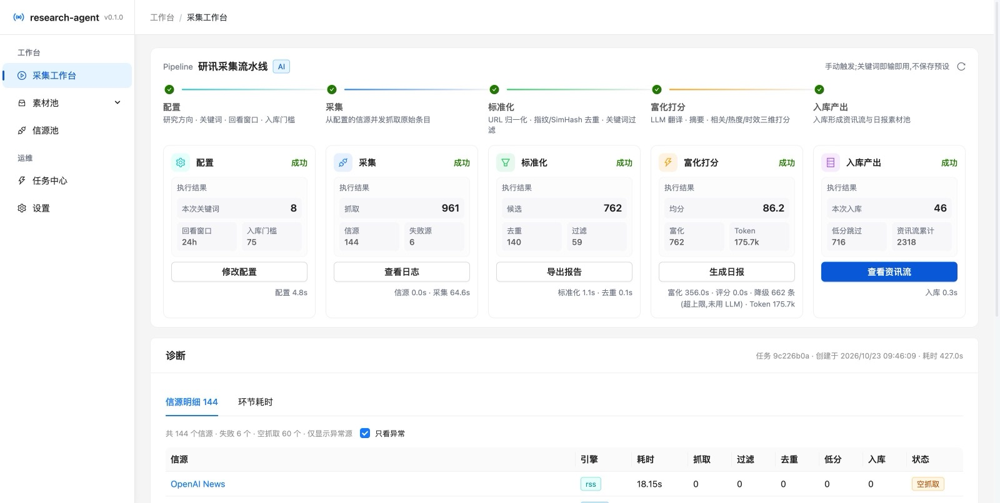
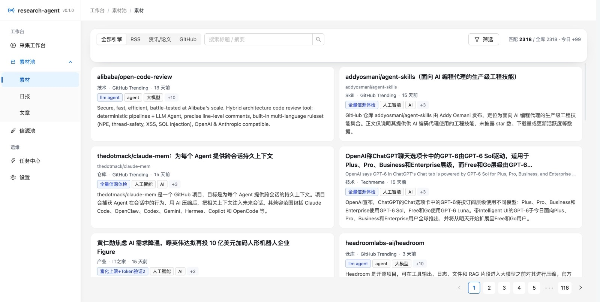
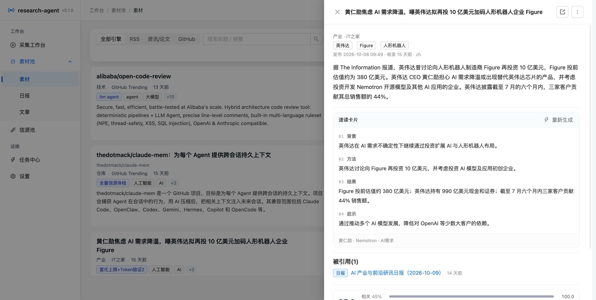
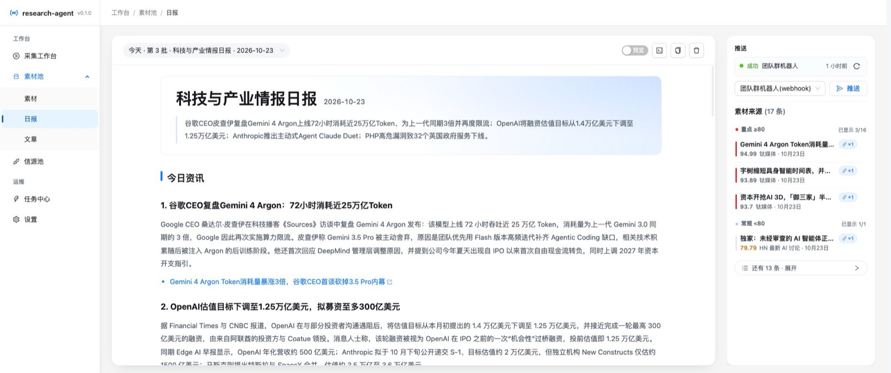
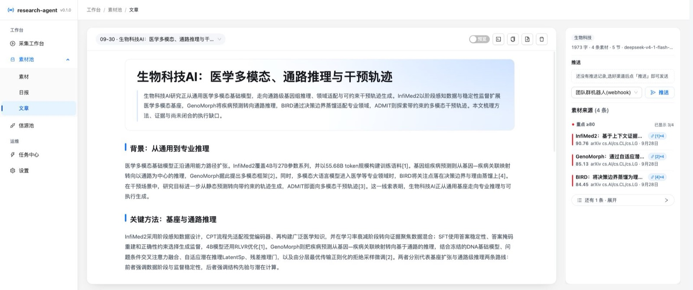
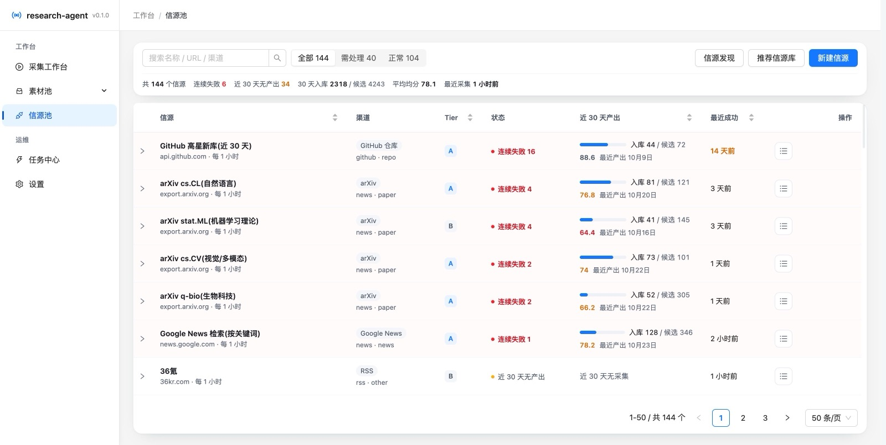
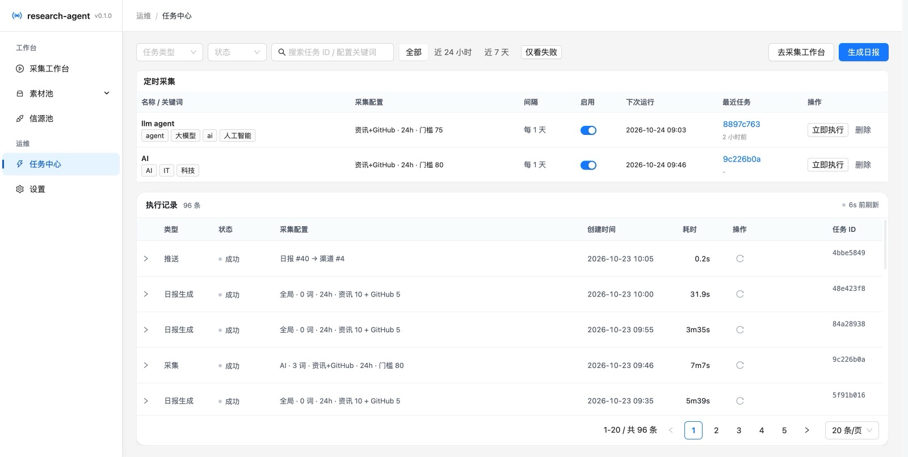
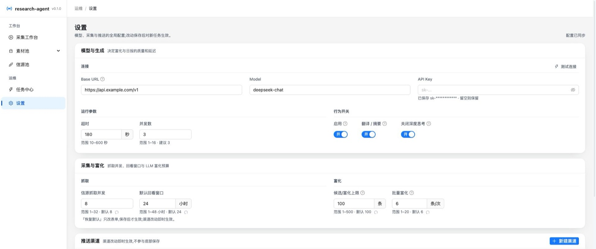
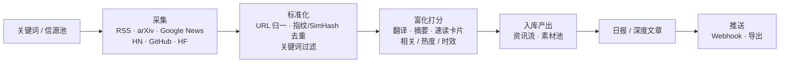

<div align="center">

# research-agent 研讯平台

**关键词驱动的研究与资讯采集平台**

给一个研究方向、一组关键词,它负责把散落在 RSS / arXiv / 新闻检索 / Hacker News / GitHub 上的内容抓回来,
去重清洗、翻译摘要、三维打分、入库沉淀,并产出可直接发布的 **日报** 与 **深度文章**,再推送到团队渠道。

<p>
  <a href="https://github.com/dongbucheng-ch/research-agent/actions/workflows/ci.yml"></a>
  <a href="LICENSE"></a>
  
  
  
  
  
  
</p>



<sub>采集工作台的流水线看板:配置 → 采集 → 标准化 → 富化打分 → 入库产出,阶段计数与耗时实时可见</sub>

---


## 它解决什么问题

做研究或写行业观察时,真正的成本不在「读」,而在「找 + 筛 + 整理」:订阅源太多、内容重复、中英文混杂、
时效与热度难判断,最后还要手工排版成一篇能发出去的日报。

research-agent 把这条链路变成一次配置 + 一个任务:

- **一次配置**:维护一份信源池(内置 173 条推荐信源),定义研究方向与关键词,设置定时采集。
- **一个任务**:点「开始采集」,后面交给流水线,所有阶段在界面上可见。
- **两种产出**:固定版式的**日报**、带 `[n]` 引用的**深度文章**,可预览 / 复制 / 推送到外部平台。

适合:技术团队的情报日报、论文与开源动态跟踪、行业资讯聚合、个人研究助理。

## 界面预览

下表截图来自本仓库实际运行的界面(数据为真实采集结果)。

### 采集工作台 `/collect`


关键词即时可用、无需预设;阶段卡片给出每个环节的关键计数(抓取 / 候选 / 去重 / 过滤 / 入库 / Token 消耗),
底部「诊断」提供信源明细与环节耗时,异常源可一键过滤。

### 素材池 · 素材 `/pool?tab=material`



卡片式素材流,按引擎(RSS / 资讯论文 / GitHub)筛选,支持标题摘要搜索与多维筛选;卡片直接展示「已加工」的结论,点开即可进原文。

### 素材详情 · 速读卡片



抽屉按「先结论、后元数据」组织:结构化速读卡片(背景 / 方法 / 结果 / 启示)、三维评分与权重、标签与实体、
被哪些日报引用、原文链接。

### 日报 `/pool?tab=digest`



固定版式:标题 + 导语 + 今日资讯 + GitHub 今日推荐,同一天多次生成按「日期 · 第 N 批」管理;
右侧信息栏承载推送、素材来源与质量分布;查看器支持 **预览 / Markdown 源码 / JSON** 三态。

### 文章 `/pool?tab=article`



深度文章由「召回 → 过滤去重 → 大纲 → 逐节写作 → 合成」生成,正文内嵌 `[n]` 引用,右侧列出对应的素材来源。

### 信源池 `/sources`



信源的健康档案:渠道与 Tier、连续失败次数、近 30 天产出与候选、平均分、最近成功时间;支持连通性测试、
推荐信源库导入与「信源发现」。

### 任务中心 `/jobs`



定时采集与执行记录集中管理:任务类型 / 状态 / 采集配置 / 耗时 / 日志,失败可筛、可重跑,执行中的日志实时落库。

### 设置 `/settings`



模型连接、运行参数、行为开关与推送渠道;改动以「未保存」状态提示,底部保存条一次性提交,附「测试连接」。

## 核心特性

### 采集:3 个引擎、9 类来源、零迁移扩展

- **三个引擎**:`rss`(标准 Feed,含 RSSHub / RSS-Bridge)、`news`(资讯与论文)、`github`(代码与模型资源)。
- **九类采集器**:RSS Feed、arXiv、Google News、Bing News、Hacker News、Hugging Face Papers、
  GitHub Trending、GitHub 仓库搜索、Hugging Face 模型;正文抽取基于 `trafilatura`,单源失败自动隔离。
- **关键词即用**:中文关键词先由 LLM 扩展 / 翻译为英文检索词,再进入采集与打分;不需要预先建库。
- **推荐信源库**:内置 173 条信源(JSON catalog),一键导入;还支持按关键词「发现」新信源。
- **定时采集**:最小 5 分钟、最长 7 天;到点自动提交,冲突时跳过并记录原因。

### 加工:可解释的去重与三维打分

- **去重三道闸**:URL 归一(canonical)、标题指纹、SimHash 近似去重。
- **三维打分**:相关度 · 热度 · 时效加权(默认 `0.45 / 0.35 / 0.20`),其中相关度 = `0.6 × 关键词命中 + 0.4 × LLM 判断`。
- **热度按渠道取真值**:GitHub 看 star 与当日增速、Hugging Face 看下载与点赞、Hacker News 看点数与评论、RSS 看时间窗。
- **时效指数衰减**:不同渠道有不同的半衰窗口(仓库 720 小时、资讯更短),而不是一刀切。
- **低分可追溯**:低于入库门槛的候选不会静默丢弃,而是以「低于门槛跳过」写进采集报告。

### 产出:日报与深度文章

- **日报**采用固定版式(导语 + 今日资讯 + GitHub 今日推荐),按「日期 · 第 N 批」管理同一天的多批次,
  生成过程中自动做长度修复与素材不足标注。
- **文章**走「召回 → 过滤 → 大纲 → 逐节并行写作 → 合成」,每节引用素材编号,可回溯到原始条目。

### 推送:Provider 注册表

- 内置 `通用 Webhook` 与 `导出` 两个 Provider;新增平台(飞书 / Discord / 邮件…)只需实现一个 `PushProvider` 文件并注册。
- 渠道支持自定义 `headers` / `token` 与 `payload_template` 占位符:
  `$title` `$lead` `$content` `$content_md` `$highlights` `$tags` `$source` `$author` `$id`。
- 推送时可临时覆盖标题 / 来源 / 作者 / 标签;标签默认按素材标签频次自动汇总。

### 可观测与诚实降级

- **全链路可视**:五个阶段的状态与计数实时更新,任务日志在运行中即时落库(不是结束后才有)。
- **诚实降级**:未配置 LLM 时全流程照常可用——不翻译、不做 LLM 摘要,只保留关键词相关度打分;
  超出上限的候选零成本降级,任务日志会标注「降级模式」,不会假装成功。
- **推理模型适配**:对强制推理模型默认发送 `thinking: disabled` 关闭深度思考;
  网关不支持该参数时自动去掉并重试(记在 `disable_thinking` 开关里)。

## 工作原理



| 阶段 | 做什么 | 产出 |
| --- | --- | --- |
| 配置 | 解析研究方向、关键词(含中文扩展)、回看窗口、入库门槛 | 采集规格与检索词 |
| 采集 | 并发抓取启用信源,正文抽取,单源失败隔离 | 原始条目 |
| 标准化 | URL 归一、标题指纹 + SimHash 去重、关键词包含/排除 | 候选条目 |
| 富化打分 | 翻译、摘要、速读卡片、三维打分(含降级分支) | 打分后的素材 |
| 入库产出 | 门槛过滤、素材入库,供日报 / 文章召回 | 资讯流、素材池 |

后台是**进程内任务执行器 + asyncio 定时循环(60s tick)**:每个任务有类型、参数、阶段、结果与日志,
启动时会把上次中断的任务标记为失败,避免「僵尸运行中」。

## 技术栈

| 层 | 选型 |
| --- | --- |
| 后端 | Python 3.12 · FastAPI · SQLAlchemy 2(async)· httpx · asyncio 定时循环 |
| 数据库 | PostgreSQL 14+(JSONB;可选向量扩展不影响本项目的表结构) |
| 前端 | React 18 · TypeScript · Vite · Ant Design 5 · TanStack Query · react-markdown |
| LLM | 任意 OpenAI 兼容接口(`/v1/chat/completions`),在设置页配置 |
| 工程 | uv(Python)· pnpm(Node)· ruff · pytest · GitHub Actions |

前端构建产物由后端静态托管,**生产形态只有一个端口**(默认 `8017`)。

## 快速开始

### 0. 前置条件

| 组件 | 版本 | 说明 |
| --- | --- | --- |
| Python | ≥ 3.12 | 用 [uv](https://docs.astral.sh/uv/) 管理依赖 |
| Node.js | ≥ 20 | 使用 pnpm 构建前端 |
| PostgreSQL | ≥ 14 | 本地 Docker 即可 |

### 1. 启动数据库

```bash
docker run -d --name research-agent-pg -p 25432:5432 \
  -e POSTGRES_USER=agent -e POSTGRES_PASSWORD=agent -e POSTGRES_DB=research_agent \
  postgres:16-alpine
```

### 2. 启动后端

```bash
cd backend
cp .env.example .env          # 填 RA_DB_HOST / RA_DB_PORT / RA_DB_USER / RA_DB_PASSWORD / RA_DB_NAME
uv sync
uv run uvicorn app.main:app --host 127.0.0.1 --port 8017
```

`RA_AUTO_CREATE_TABLES=true`(默认)时启动自动建表;当前使用 `Base.metadata.create_all`,尚未接入 alembic 迁移。

### 3. 构建前端

```bash
cd frontend
pnpm install
pnpm build                    # 产物 frontend/dist,由后端托管
```

打开 <http://127.0.0.1:8017/> 即为完整应用;接口文档在 <http://127.0.0.1:8017/docs>。

> 前端开发模式:`pnpm dev` 跑在 `5174`,已把 `/api` 代理到 `127.0.0.1:8017`,可热更新调试。

## 配置

### 环境变量(`backend/.env`,前缀 `RA_`)

| 变量 | 说明 |
| --- | --- |
| `RA_DB_HOST` / `RA_DB_PORT` / `RA_DB_USER` / `RA_DB_PASSWORD` / `RA_DB_NAME` | 分字段填写连接,避免密码含 `@` `!` 时的 DSN 转义问题(**推荐**) |
| `RA_DATABASE_URL` | 可选,完整 DSN(`postgresql+asyncpg://…`),与上者二选一 |
| `RA_AUTO_CREATE_TABLES` | 启动时自动建表,默认 `true` |
| `RA_API_TOKEN` | 可选,开启后所有 `/api/*` 需带 `Authorization: Bearer <token>` |
| `RA_GITHUB_TOKEN` | 可选,提高 GitHub Trending / Search 的 API 限额 |
| `RA_LLM_BASE_URL` / `RA_LLM_MODEL` / `RA_LLM_API_KEY` | 可选,环境变量优先于界面配置 |
| `RA_LOG_LEVEL` | 日志级别,默认 `INFO` |

## 项目结构

```text
research-agent
├── backend
│   ├── app
│   │   ├── api/routes/       sources · items · digests · articles · jobs · schedules · settings · stats
│   │   ├── collectors/       rss · arxiv · google_news · bing_news · hackernews · hf_papers
│   │   │                     github_trending · github_search(仓库/模型)· extract(正文抽取)
│   │   ├── pipeline/         text.py(去重清洗)· enrich.py(LLM 富化 + 降级)· scoring.py(三维打分)
│   │   ├── prompts/          *.md —— 富化 / 日报 / 文章 / 关键词 的提示词模板
│   │   ├── services/         llm · app_settings · fetch_service · digest_service · article_service
│   │   │                     item_enrich · keyword_expand · keyword_translate · discovery
│   │   │                     github_today · jobs · schedules · stage_tracker · push/
│   │   ├── models/ schemas/ core/
│   │   └── main.py           FastAPI 入口(API 路由 + 前端静态托管)
│   ├── resources/            recommended_sources.json(推荐信源库,173 条)
│   ├── scripts/              维护脚本(清理旧主题、刷新旧卡片)
│   ├── tests/                pytest(默认不依赖数据库)
│   ├── pyproject.toml        · uv.lock
│   └── .env.example          环境变量模板
├── frontend
│   ├── src
│   │   ├── pages/            CollectPage · PoolPage · SourcesPage · JobsPage · SettingsPage
│   │   ├── components/       AppLayout · PipelineBoard · ItemDetailDrawer · JobLogViewer
│   │   │                     PushSection · SchedulesCard · pool/(素材与产出组件)
│   │   ├── api/              client.ts · types.ts
│   │   ├── App.tsx           路由表
│   │   └── styles.css        全局样式(按页面分区维护)
│   ├── vite.config.ts        开发端口 5174,代理 /api → 8017
│   └── package.json
├── docs
│   ├── mvp-plan.md           分类体系、数据模型、流水线、打分公式
│   ├── collect-engine-plan.md 采集引擎与产出模式方案
│   ├── roadmap-p0-p4.md      迭代路线图与变更记录
│   ├── source-health-*.md    信源可用性巡检记录
│   ├── screenshots/          界面截图(README 引用)
│   └── sponsor/              微信二维码(wechat.png,替换同名文件即可)
├── .github/workflows/ci.yml  后端 ruff + pytest,前端 typecheck + build
├── CONTRIBUTING.md
├── THIRD_PARTY_NOTICES.md
└── LICENSE
```

## 开发与测试

```bash
# 后端:静态检查 + 单元测试(当前 155 passed,不依赖数据库)
cd backend && uv run ruff check . && uv run pytest -q

# 前端:类型检查 + 生产构建
cd frontend && pnpm typecheck && pnpm build

```

## 常见问题

<details>
<summary><b>没有配置 LLM,能用吗?</b></summary>

可以。采集、去重、入库、素材池、任务中心都无需 LLM;此时不翻译、不做 LLM 摘要与 LLM 相关度判断,
只保留关键词相关度打分,日志会标注降级模式。日报会退化为模板化版本。
</details>

<details>
<summary><b>日报 / 文章生成很慢,或者一直转圈?</b></summary>

优先检查模型是否是**强制推理模型**(如 DeepSeek 系):这类模型默认会输出大量 reasoning token,
导致读超时并触发降级。设置页的「关闭深度思考」默认开启(向网关发送 `thinking: disabled`),
网关不支持时会自动去掉该参数并重试。其次看任务中心里该任务的分阶段日志,定位耗时环节。
</details>

<details>
<summary><b>数据库密码含 <code>@</code> <code>!</code> 等字符连不上?</b></summary>

用 `RA_DB_HOST` / `RA_DB_PORT` / `RA_DB_USER` / `RA_DB_PASSWORD` / `RA_DB_NAME` 分字段配置,
不要拼成单条 DSN;若必须用 `RA_DATABASE_URL`,密码需要 URL 编码。
</details>

<details>
<summary><b>本地请求全部失败,但 curl 正常?</b></summary>

shell 里可能存在 `all_proxy` / `http_proxy`。后端走 `httpx`(已装 `socksio`),本地联调时把代理或
`NO_PROXY` 配好;用 curl 做健康检查时加 `--noproxy '*'`。
</details>

<details>
<summary><b>GitHub 采集频繁触发限额?</b></summary>

配置 `RA_GITHUB_TOKEN` 提高限额;也可以把 GitHub 相关信源的 `fetch_interval_minutes` 调大,
或只保留 Trending / Search 中的一路。
</details>

<details>
<summary><b>改了模型后表结构怎么迁移?</b></summary>

当前由 `RA_AUTO_CREATE_TABLES` + `Base.metadata.create_all` 建表,尚未引入 alembic 迁移;
结构性变更请结合回归测试与文档同步更新。
</details>

## 贡献

欢迎 Issue 与 PR。开始之前建议先读 [CONTRIBUTING.md](CONTRIBUTING.md);
UI 相关的改动请附截图,涉及数据模型或共享契约的改动请附带回归测试。

## 交流与支持

如果 research-agent 帮你省下了找资料、筛内容、排日报的时间,可以请作者喝杯咖啡 ☕

<p align="center">
  
</p>

> 也欢迎用 Star、Issue 和 PR 支持:把项目分享给同样需要做信息采集与日报的同事,比打赏更管用。
